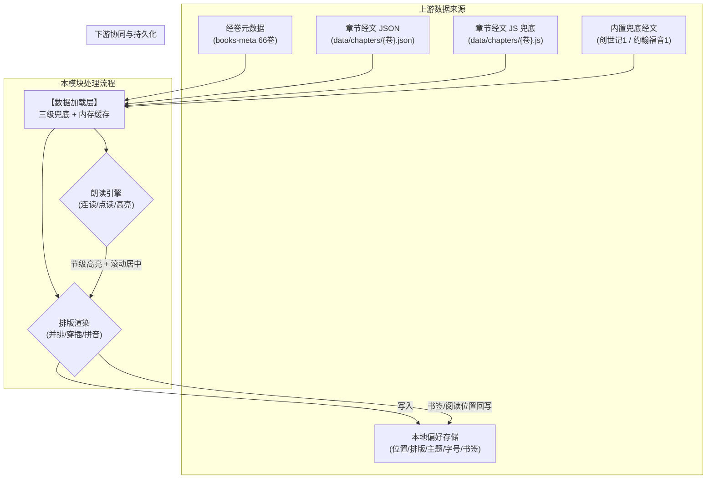

# 页面PRD · 中英双语对照圣经阅读器 (PC)

> [!IMPORTANT]
> **【B】本模块为全新新增模块**：个人阅读工具 Demo，无基线系统。本目录全部文档为正式设计范围。

---

## 需求描述

【中英双语对照圣经阅读器】是个人读经与语言对照的单页阅读工具：收录中文简体和合本（CUV）与 NIV 1984 英文全卷 66 卷，按「书卷 → 章 → 节」逐节对照展示，并提供英文朗读、拼音大字版与章节书签能力。

**适用场景**：个人日常读经查经、中英对照学习、长辈大字拼音阅读。

### 1、业务责任角色

- **普通读者**：单用户本地使用，无登录与权限概念；执行阅读、翻章、收藏、朗读、排版与主题切换；
- **本地数据加载层**：负责经卷元数据与章节经文的多级加载与缓存兜底；
- **浏览器语音合成引擎**：承担英文经文的发音与逐节播报任务。

### 2、核心业务规则

1. **三级导航定位**：全书 66 卷按旧约 39 / 新约 27 分组；用户必须先选卷再选章进入阅读，章内按节逐行展示；
2. **阅读位置记忆**：每次切卷/切章，系统记录当前书卷与章号；下次打开自动恢复上次阅读位置；
3. **排版模式互斥**：并排 / 穿插 / 拼音三种排版单选生效；拼音模式为「长辈极简模式」，隐藏全部英文相关界面元素（英文栏、朗读坞、点读开关、PDF 链接、收藏按钮）；
4. **章节书签去重**：书签粒度为「卷 + 章」。如果当前章已收藏，再次点击收藏按钮执行取消；书签按收藏时间倒序排列，可单条删除、可跳转；
5. **朗读开关默认关闭**：点读开关关闭时点击经节不发声；整章连读从第 1 节顺序播报，单节点读仅读所选节；
6. **数据多级兜底**：经卷数据依次尝试「`<script>` 预载 → fetch JSON → `<script>` 动态注入 → 内置兜底经文」，任何一级失败自动降级，页面不得白屏。

---

## 数据流转

### 数据来源

1. **经卷元数据**：`books-meta` 经 `<script>` 预载提供 66 卷名录（卷名中/英、约别、分组、章数、PDF 地址）；
2. **章节经文**：按卷 slug 加载整卷 JSON（fetch 失败时降级 `<script>` 注入 JS 版本，再降级内置兜底经文）；
3. **本地偏好**：阅读位置、排版模式、主题、字号、点读开关、书签列表均读自浏览器本地存储；
4. **用户操作**：收藏/取消书签、切卷切章、排版与朗读控制实时写入状态与本地存储。

### 数据影响与下游协同

1. **阅读位置回写**：切卷/切章时持久化最近位置，下次启动恢复；
2. **书签落盘**：收藏/删除即时写入本地书签数组，刷新后保留；
3. **朗读反馈**：播报至第 N 节时对应经节行高亮并滚动至视口中央；
4. **外链跳转**：副栏 PDF 徽章外链至对应卷 NIV 1984 原版 PDF。

---

## 页面主要内容与字段信息

### 1. 阅读区字段信息

| 字段名称 | 控件类型 | 必填性 | 字典 / 数据源 | 规格与校验规则 |
| :--- | :--- | :---: | :--- | :--- |
| **章节主标题** | 纯文本 | **是** | 当前卷名 + 章号 | 格式「{卷名} 第 {n} 章」 |
| **章节英文副标** | 纯文本 | **是** | 卷英文名 + 章号 | 格式「{En Name} Chapter {n} (NIV 1984)」；拼音模式隐藏 |
| **节号** | 纯文本徽章 | **是** | 经节序号 | 每节起始，正整数 |
| **中文经文** | 纯文本 | **是** | 和合本简体 | 缺失显示「（待补充）」；字符间多余空白自动收拢 |
| **英文经文** | 纯文本 | **是** | NIV 1984 | 缺失显示「（Pending NIV 1984 text）」；并排模式右栏、穿插模式中文下方 |
| **拼音标注** | ruby 上标注 | 否 | 逐字拼音（`\|` 分隔与中文逐字对齐） | 仅拼音模式；长度不符自动降级纯汉字 |

### 2. 书签条目字段信息（抽屉书签 Tab）

| 字段名称 | 控件类型 | 必填性 | 数据源 | 规格与校验规则 |
| :--- | :--- | :---: | :--- | :--- |
| **书签名** | 纯文本 | **是** | 收藏时卷名快照 | 格式「{卷名} 第{n}章」 |
| **英文副标** | 纯文本 | **是** | 收藏时卷英文名快照 | 格式「{En Name} Ch.{n}」 |
| **删除按钮** | 图标按钮 | **是** | — | 点击即从书签数组移除，无需二次确认 |
| **当前高亮** | 状态样式 | 否 | 当前卷章比对 | 命中当前阅读章时条目金色高亮 |

---

## 按钮与操作信息

### 1. 顶栏操作

- **卷章目录**：点击打开右侧抽屉目录；
- **点读开关**：双态切换「点读: 关 / 点读: 开」，关闭时进行中的朗读立即停止；
- **排版切换**：并排 / 穿插 / 拼音三选一分段控件；
- **字号 A- / A+**：按当前模式步进调节，到达上下限时 Toast 提示；
- **主题**：羊皮纸 → 洁白 → 深夜循环切换。

### 2. 副栏操作

- **上一章 / 下一章**：章间翻页；卷首/卷尾对应按钮置灰禁用；
- **☆ 收藏**：未收藏点击 → 收藏当前章（金色实心 + 「已收藏」）；已收藏点击 → 取消收藏；
- **点读状态胶囊**：与顶栏点读开关联动的快捷状态按钮；
- **NIV PDF**：新窗口打开对应卷 PDF。

### 3. 抽屉目录操作

- **搜索框**：按卷名中/英模糊过滤书卷列表与书签列表；
- **旧约 / 新约 / 书签 Tab**：切换列表内容；书签 Tab 下点击条目跳转目标章；
- **卷条目**：点击进入该卷章号网格（6 列），章号点击即跳转并关抽屉；
- **返回书卷目录**：章号网格视图返回卷目列表。

### 4. 朗读坞操作（拼音模式隐藏）

- **播放 / 暂停**：整章连读控制，播放中显示波形动画；
- **上一节 / 下一节**：逐节跳转朗读；
- **语速**：0.75x / 1.0x / 1.2x / 1.5x；
- **发音人**：浏览器可用英文 Voice 下拉。

---

## 关联下级与全局交互规范

1. **书签防呆**：同一「卷+章」重复收藏视为取消操作，不产生重复条目；
2. **数据兜底**：JSON 加载失败自动降级 `<script>` 版本，再降级内置经文；本地存储解析失败按空值处理，不阻断渲染；
3. **空态反馈**：经文为空显示「本章节正在加载或整理中」；书签为空显示引导文案；
4. **操作反馈**：收藏、字号到限、点读开关等操作经全局 Toast 轻提示；
5. **书签失效处理**：跳转书签时若卷 slug 无法匹配元数据，提示并自动移除该书签；
6. **离线可用**：纯静态无后端，`file://` 双击即开，全部状态仅存浏览器本地。

---

> 子文档：[阅读器主界面.md](./阅读器主界面.md) ｜ [字段备注清单.md](./字段备注清单.md)
